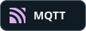

# M. Andi Abdillah

**Embedded systems engineer** working across firmware, electronics, and robotics.

I build systems that connect sensors, controllers, and software. My projects span autonomous vessels, water-quality monitoring and control, educational robotics, and assistive computer vision.

[Selected work](#selected-work) · [Languages and tools](#languages-and-tools) · [GitHub activity](#github-activity) · [LinkedIn](https://www.linkedin.com/in/m-andi-abdillah/)

## Selected work

### Autonomous surface vessel · Barunastra ITS

I developed the concept for a system-wide redesign and rewrote the vessel’s STM32 firmware. Our team reduced the board footprint by about **70%** and took **1st place at RoboBoat 2025**. [RoboNation competition results](https://robonation.org/record-breaking-roboboat-2025-showcases-the-future-of-autonomous-maritime-technology/)

### Adaptive voice guidance · Assistive AI

For my electrical engineering thesis at ITS, I built a local pipeline that uses a smartphone camera and microphone to guide blind users to the right button on an unfamiliar AC remote. The system combines oriented object detection, vision-language reasoning, and spoken feedback. [Source code and evaluation](https://github.com/AndiArvy/asistif-code)

### Smart aquaculture · BRIN

I built a Python/MQTT bridge for a tilapia farming system. The bridge relays water-quality telemetry and handles control commands for aeration, water temperature, and feeding.

### Educational robotics

I designed KiCad controller boards for Arduino Nano and ESP32 learning robots. The boards support robotics modules for primary and middle school students.

## Languages and tools

**Firmware & electronics**

  
  
  
  
  

**Software & telemetry**

  
  

## GitHub activity

The spectrum animates daily contribution counts as the scanner moves through each week. Busier weeks push the signal into higher bands. The underlying calendar refreshes daily through GitHub Actions.

<picture>
  <source media="(prefers-reduced-motion: reduce)" srcset="./assets/contributions.svg#reduced-motion" />
  
</picture>
