# M. Andi Abdillah

**Electrical engineer** focused on embedded systems, robotics, and industrial IoT.

I'm an Electrical Engineering graduate from Institut Teknologi Sepuluh Nopember (ITS) and an R&D Engineer Intern at PT Aldzama. I also take on freelance electronics projects from schematic design and C/C++ firmware through hardware integration and testing.

[Selected work](#selected-work) · [Languages and tools](#languages-and-tools) · [GitHub activity](#github-activity) · [LinkedIn](https://www.linkedin.com/in/m-andi-abdillah/)

## Selected work

### Autonomous surface vessel · Barunastra ITS

As Electrical and Programming Division Lead, I proposed a system-wide redesign and rewrote the vessel’s STM32 firmware. I integrated sensor fusion, actuator control, and communication with onboard Linux computers. Our team reduced the board footprint by about **70%** and took **1st place at RoboBoat 2025**. [RoboNation competition results](https://robonation.org/record-breaking-roboboat-2025-showcases-the-future-of-autonomous-maritime-technology/)

### PLC-controlled demolition robot · PT Aldzama

I proposed a system architecture aimed at lowering the cost of in-house development for a PLC-controlled industrial demolition robot. The project is in early development.

### Adaptive voice guidance · Assistive AI

For my thesis at ITS, I built a local pipeline that uses a smartphone camera and microphone to guide blind users to the right button on an unfamiliar AC remote. The system combines YOLO oriented object detection, local vision-language reasoning, WebRTC, and Faster-Whisper. [Source code and evaluation](https://github.com/AndiArvy/asistif-code)

### Smart aquaculture · BRIN

I integrated water-quality sensors and built Python/MQTT bridge workflows for a tilapia farming system. The bridge relays dissolved oxygen, pH, conductivity, temperature, and ammonia readings and handles control commands for aeration, temperature, and feeding.

### Educational robotics

I designed two KiCad carrier boards for Arduino Nano and ESP32 learning robots. The two-layer PCBs integrate motor drivers, sensors, displays, and power circuitry for primary and middle school robotics modules.

### Prometheus · Google Gemma Hackathon

I led Android development and data architecture for a Kotlin Multiplatform disaster-guidance app that uses Jetpack Compose and on-device Gemma inference.

## Languages and tools

**Embedded systems and electronics**

  
  
  
  
  
  

Schematic and PCB design, sensor interfacing, motor control, and power distribution.

**Integration and automation**

  
  
  
  
  

`UART` · `I²C` · `SPI` · `RS-232` · `RS-485` · Ladder logic, hardware–software debugging, and field testing.

**Robotics, computer vision, and edge AI**

  
  
  
  

**Application development**

  
  
  

**Spoken languages** · Indonesian (native) · English (professional working proficiency)

## GitHub activity

The oscilloscope runs at 1 Hz below a weekly average of 12 contributions per day. It switches to 2 Hz at 12, 4 Hz at 17, and 8 Hz at 24. The wave gets taller with more activity, and idle weeks show a small heartbeat. The calendar refreshes daily through GitHub Actions.

<picture>
  <source media="(prefers-reduced-motion: reduce)" srcset="https://raw.githubusercontent.com/AndiArvy/AndiArvy/contribution-assets/contributions.svg#reduced-motion" />
  
</picture>
