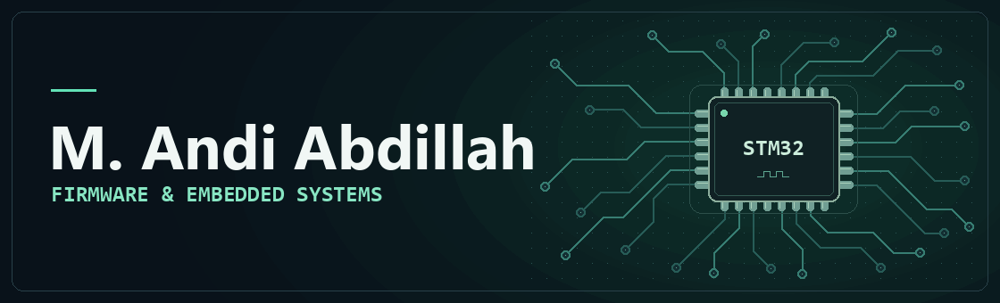

  

I build firmware and electronics for robots and connected devices, from sensor interfaces and PCB design to system integration and field testing.

[Connect on LinkedIn](https://www.linkedin.com/in/m-andi-abdillah/)

### Selected work

- **Autonomous surface vessel · Barunastra ITS** — Rewrote the STM32 firmware and redesigned the electronics, reducing PCB size by about 70%. Our team placed **1st in the RoboBoat Autonomy Challenge (2025)**.
- **Smart aquaculture · BRIN** — Built a Python/MQTT bridge to process water-quality telemetry and relay actuator commands.
- **Educational robotics** — Designed KiCad carrier boards for Arduino Nano and ESP32 with motor, sensor, and display interfaces.

### Toolkit

`C/C++` · `STM32` · `ESP32` · `KiCad` · `Python` · `MQTT`
