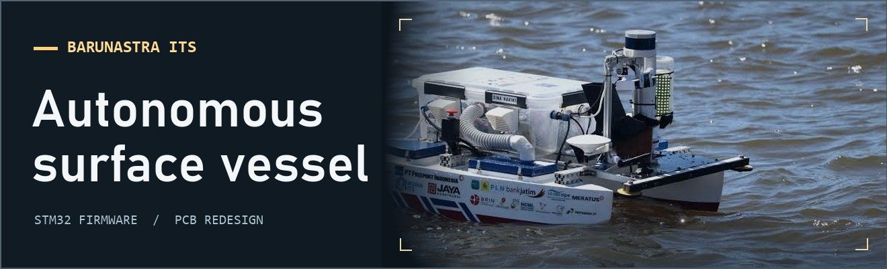

# M. Andi Abdillah

**Embedded systems engineer** · Firmware, electronics, and robotics · [LinkedIn ↗](https://www.linkedin.com/in/m-andi-abdillah/)

At **Barunastra ITS**, I rewrote the vessel’s STM32 firmware and redesigned the electronics, reducing PCB size by about **70%**. Our team took **1st place at RoboBoat 2025**.

- **Smart aquaculture · BRIN** — Built a Python/MQTT bridge for water-quality telemetry and actuator control.
- **Educational robotics** — Designed KiCad controller boards for Arduino Nano and ESP32 learning robots.

`C/C++` · `STM32` · `ESP32` · `KiCad` · `Python` · `MQTT`

